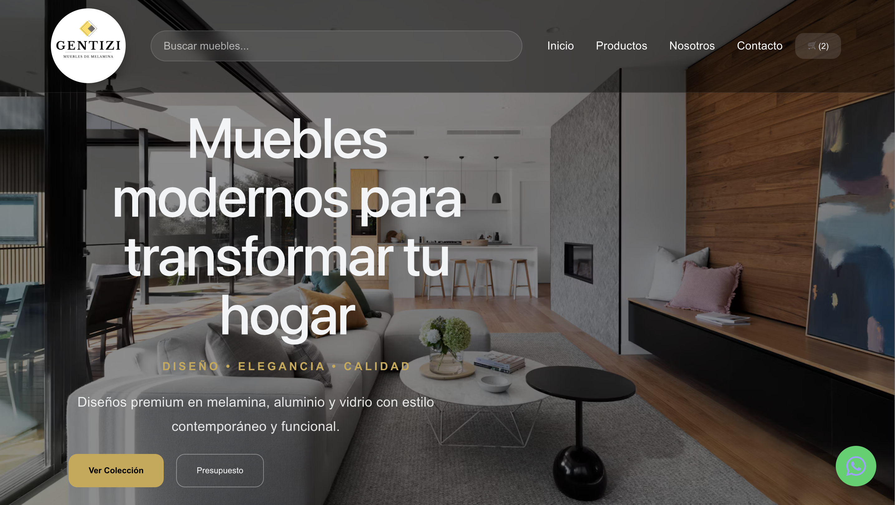

# Gentizi Ecommerce

An online furniture store developed for my own melamine furniture business.

This project was created to bring my furniture business into the digital space, allowing customers to explore products, browse categories, customize product finishes, and prepare orders through WhatsApp.

## 🌐 Live Demo

[Visit Gentizi Ecommerce](https://gentizi-ecommerce.vercel.app/)

## 📸 Preview



## ✨ Features

- Product catalog with furniture images and prices.
- Product categories: Racks, Tables, and Panels.
- Product search by name, category, and description.
- Category-based product filtering.
- Product detail pages.
- Shopping cart with quantity management.
- Automatic cart total calculation.
- Product finish selection details in the cart.
- Cart data persistence using LocalStorage.
- Order summary generation.
- WhatsApp integration to send order inquiries.
- Mobile navigation menu.
- Scroll-based animations.

## 🛠️ Technologies

- React 19
- JavaScript
- Vite
- React Router DOM
- CSS3
- LocalStorage
- AOS (Animate On Scroll)
- WhatsApp integration

## 📂 Project Structure

```text
src/
├── assets/
├── components/
├── data/
├── pages/
├── styles/
├── App.jsx
├── App.css
├── index.css
└── main.jsx
```

## 🚀 Getting Started

To run this project locally:

1. Clone the repository:

```bash
git clone https://github.com/Matt091088/gentizi-ecommerce.git
```

2. Navigate to the project folder:

```bash
cd gentizi-ecommerce
```

3. Install dependencies:

```bash
npm install
```

4. Start the development server:

```bash
npm run dev
```

## 👨‍💻 Development

Independently designed and developed by me, with AI-assisted guidance throughout the development process.

This project combines my experience in the furniture business with my ongoing learning and development in frontend technologies.

